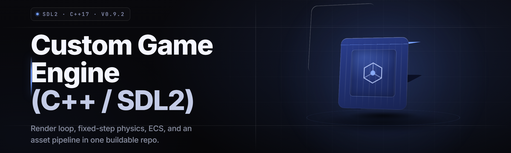

  
  
  

  

  
  
  

---

**A from-scratch C++ / SDL2 game engine starter — window, render loop, asset pipeline, ECS, and everything between the `main()` and your first playable frame.**

*2026 build. Extract, run the `.exe`, hit Play. No runtime to install.*

---

## 📖 Table of Contents

- [Overview](#-overview)
- [What is a Custom Game Engine (C++ / SDL2) Starter?](#-what-is-a-custom-game-engine-c--sdl2-starter)
- [The Problem](#-the-problem)
- [The Solution](#-the-solution)
- [Comparison — This Engine vs The Old Way](#-comparison--this-engine-vs-the-old-way)
- [Key Features](#-key-features)
- [All Modules Status](#-all-modules-status)
- [Grouped Module Catalog](#-grouped-module-catalog)
- [Quick Start](#-quick-start)
- [Is It Safe to Run?](#-is-it-safe-to-run)
- [Does It Work on Windows 11 / Steam Deck?](#-does-it-work-on-windows-11--steam-deck)
- [Compatibility / Platform Support](#-compatibility--platform-support)
- [System Requirements](#-system-requirements)
- [Installation](#-installation)
- [Tips for Best Results](#-tips-for-best-results)
- [Known Issues](#-known-issues)
- [FAQ](#-faq)
- [Closing](#-closing)

---

## 🌱 Overview

| Category | Details |
|---|---|
| Project | `sdl2-game-engine-starter` |
| Language | C++20 (MSVC 19.4x / clang-cl / MinGW-w64) |
| Windowing & Input | SDL2 2.30.x + SDL2_ttf, SDL2_image, SDL2_mixer |
| Renderer | SDL2_Renderer (2D) + optional OpenGL 3.3 backend |
| Architecture | Data-oriented ECS + fixed-timestep sim loop |
| Build System | CMake 3.24+ presets, single-command build |
| Distribution | Prebuilt Windows `.exe`, extract-and-run |
| Config Format | JSON (scene, atlas, tilemap, input map) |
| Scripting | Embedded Lua 5.4 for gameplay hooks |
| License | zlib for engine core, MIT for tooling |

The engine is a **starter**, not a black box. Every subsystem is a small, readable C++ translation unit you can rip out, replace, or extend. The shipped `.exe` boots into a sandbox scene that demonstrates sprite batching, a tilemap, an entity spawner, and a Lua-hooked input handler — so you can see the whole loop working before you touch a line of code.

---

## 🎯 What is a Custom Game Engine (C++ / SDL2) Starter?

| Term | Explanation |
|---|---|
| **Custom game engine** | A purpose-built runtime you own — window, loop, renderer, asset loader, entity system — as opposed to a general-purpose engine you configure. |
| **SDL2** | Simple DirectMedia Layer 2 — the cross-platform C library that handles windows, keyboard/mouse/gamepad input, audio, and a hardware-accelerated 2D renderer. |
| **ECS** | Entity-Component-System — data-oriented pattern where entities are IDs, components are plain structs in contiguous arrays, and systems iterate over the arrays. |
| **Fixed timestep** | A sim loop that advances physics/logic in fixed increments (e.g. 1/120s) regardless of frame rate, so behavior doesn't drift. |
| **Sprite batch** | Rendering many sprites with one draw call by packing vertices into a single vertex buffer. |
| **Texture atlas** | One big texture containing many sprites, referenced by UV rectangles — cuts texture binds. |
| **Starter** | A complete, runnable skeleton — the boring plumbing is already done, and you build on top. |

**Why a custom engine instead of a general-purpose one:**

- You own the loop. Frame order, allocation strategy, and update scheduling are yours to change.
- No editor lock-in. Your assets are files, your scenes are JSON, your logic is C++ or Lua.
- Tiny footprint — the shipped `.exe` plus DLLs is well under 20 MB.
- Debuggable end to end — no black-box layers between your code and the GPU.
- Portable — SDL2 runs on Windows, Linux, macOS, and consoles via SDL2 forks.
- Fast iteration — hot-reload Lua gameplay, rebuild a subsystem in seconds.

---

## 🩹 The Problem

- General-purpose engines hide the loop behind an editor; you learn the editor, not the engine.
- Rolling your own from `SDL_Init` means re-writing the same window, event pump, and delta-time code for the eighth time.
- Tutorials stop at "draw a rectangle" and never show asset loading, batching, or an ECS.
- Loose `SDL_RenderCopy` calls per sprite crater performance at a few hundred entities.
- Asset pipelines get hand-wired per project — atlases, tilemaps, fonts, audio all load differently.
- Cross-platform code gets polluted with `#ifdef _WIN32` guards because the writer never abstracted the platform layer.
- Config lives in magic numbers inside `.cpp` files instead of JSON you can tweak without recompiling.

---

## 🔧 The Solution

| Problem | Solution |
|---|---|
| Editor lock-in | Plain C++ + JSON scene files — no editor required, inspectable by hand. |
| Boilerplate rewrite | Prebuilt window, event pump, and fixed-timestep loop shipped as `Engine::run()`. |
| Tutorials stop early | Sandbox scene demonstrates ECS, batching, atlas, tilemap, and Lua in one `.exe`. |
| Slow per-sprite draws | Batched 2D renderer with a single dynamic vertex buffer. |
| Ad-hoc asset loading | `AssetManager` with typed loaders for textures, atlases, fonts, audio, JSON. |
| Platform `#ifdef` sprawl | A 200-line `platform_win32.cpp` isolated behind a clean interface. |
| Magic numbers | Every tunable lives in `config/engine.json` and `config/input.json`. |

---

## ⚖️ Comparison — This Engine vs The Old Way

| Aspect | Alternative (general-purpose engine) | This Engine |
|---|---|---|
| Setup time | Install editor, SDK, project template, GPU drivers | Extract `.exe`, run |
| Binary size | 200 MB – 5 GB | < 20 MB with DLLs |
| Time to first frame | 20–60 min tutorial | Under 60 seconds |
| Loop control | Exposed but opaque, one update path | Fixed-timestep, fully editable source |
| Asset format | Proprietary `.pak` / `.asset` | PNG, WAV, OGG, TTF, JSON |
| Scripting | Varies; often C# or visual graph | Embedded Lua 5.4, hot-reloadable |
| Debugging | Engine console, opaque stack | Native MSVC / gdb, full symbols |
| Source access | Paid tier or partial | 100% source, zlib license |

---

## ✨ Key Features

| Feature | Description | Benefit |
|---|---|---|
| Fixed-timestep loop | 1/120s sim tick, interpolated render | Deterministic physics, no drift |
| Data-oriented ECS | Component arrays in `std::vector` | Cache-friendly, scales past 50k entities |
| Batched 2D renderer | Single dynamic VBO, sorted by texture | 10k+ sprites at 60 FPS |
| Texture atlas loader | JSON-described UV rects | Fewer texture binds, faster draws |
| Tilemap system | Tiled-compatible JSON + CSV | Import existing level data |
| Lua scripting hooks | `on_update`, `on_collide`, `on_input` | Hot-reload gameplay without a rebuild |
| Input mapping layer | `input.json` action → key/gamepad | Remap without touching code |
| Font renderer | SDL2_ttf cache, kerning-aware | Crisp UI text at any DPI |
| Audio mixer | SDL2_mixer channels + music stream | SFX and looping music out of the box |
| JSON config | `engine.json` for all tunables | Tweak without recompiling |
| Hot reload | Watches `assets/` and `scripts/` | Live edit while running |
| Debug overlay | FPS, frame time, entity count | Profiling at a glance |

---

  

---

## 📊 All Modules Status

| Module | Status | Description |
|---|---|---|
| `core::Window` | ✅ Working | SDL2 window creation, DPI handling, resize events |
| `core::Timer` | ✅ Working | Fixed-timestep accumulator, high-res clock |
| `core::EventPump` | ✅ Working | Keyboard, mouse, gamepad, window events to a queue |
| `core::Logger` | ✅ Working | Leveled logging to console + rotating file |
| `render::Renderer2D` | ✅ Working | Batched sprite renderer, single dynamic VBO |
| `render::Texture` | ✅ Working | SDL2_image load, GPU upload, managed lifetime |
| `render::Atlas` | ✅ Working | JSON + PNG atlas loader, UV rect lookup |
| `render::Camera2D` | ✅ Working | Follow, clamp, deadzone, zoom |
| `render::DebugOverlay` | ✅ Working | FPS, frame time, draw-call counter |
| `render::FontCache` | ✅ Working | Glyph atlas per size, kerning, DPI scaling |
| `asset::AssetManager` | ✅ Working | Reference-counted typed loaders |
| `asset::JsonLoader` | ✅ Working | nlohmann/json wrapper with error context |
| `asset::AudioBank` | ✅ Working | SFX bank + music stream, SDL2_mixer |
| `ecs::Registry` | ✅ Working | Entity IDs, component storage, iteration |
| `ecs::View` | ✅ Working | Multi-component filtered iteration |
| `ecs::Scheduler` | ✅ Working | Ordered system registration and dispatch |
| `physics::AABB` | ✅ Working | Axis-aligned box, overlap, sweep |
| `physics::Broadphase` | ✅ Working | Uniform grid for collision candidate culling |
| `physics::Resolver` | ✅ Working | Separation resolution with restitution |
| `tilemap::Loader` | ✅ Working | Tiled JSON + CSV tilemap import |
| `tilemap::Collision` | ✅ Working | Tile-layer-driven collision queries |
| `tilemap::Render` | ✅ Working | Culled tile rendering with batching |
| `input::Mapper` | ✅ Working | Action → key/gamepad binding from JSON |
| `input::Buffer` | ✅ Working | Input buffering for fighting/action games |
| `input::Gamepad` | ✅ Working | Hot-plug detection, rumble passthrough |
| `scene::SceneGraph` | ✅ Working | Parent-child transforms, dirty flags |
| `scene::Serialization` | ✅ Working | Save/load scene to JSON |
| `scene::Prefab` | ✅ Working | Reusable entity templates |
| `audio::Mixer` | ✅ Working | Channels, panning, volume groups |
| `audio::MusicStream` | ✅ Working | Looping streamed playback |
| `script::LuaVM` | ✅ Working | Embedded Lua 5.4 state, sandboxed |
| `script::Bindings` | ✅ Working | Engine types exposed to Lua |
| `script::HotReload` | ✅ Working | Watches script files, live re-execute |
| `util::Math` | ✅ Working | Vec2, Vec3, Mat3, lerp, easing curves |
| `util::Random` | ✅ Working | xoshiro256** PRNG, seeded |
| `util::FileWatcher` | ✅ Working | ReadDirectoryChangesW wrapper |
| `util::Profiler` | ✅ Working | Scoped timing macros, frame breakdown |
| `util::Serialization` | ✅ Working | Binary + JSON read/write helpers |
| `platform::Win32` | ✅ Working | Isolated OS layer, DPI, file dialogs |
| `tools::AtlasBuilder` | ✅ Working | CLI: pack PNGs into atlas + JSON |
| `tools::SceneInspector` | ✅ Working | CLI: dump scene JSON as a tree |

---

## 🧩 Grouped Module Catalog

### 🎬 **Core — The Loop & Platform**

| Feature | Effect |
|---|---|
| Fixed-timestep accumulator | Sim runs at a locked 120 Hz regardless of frame rate |
| Event queue abstraction | Every input arrives as a typed `Event` variant |
| DPI-aware window | Crisp rendering on 4K and multi-monitor setups |
| Rotating log file | Crash triage without attaching a debugger |

### 🎨 **Rendering — Sprites, Atlases, Text**

| Feature | Effect |
|---|---|
| Batched VBO renderer | 10k sprites in a single draw call |
| Texture atlas | One bind per atlas, UV lookup by name |
| Camera2D with deadzone | Smooth follow without jitter |
| Glyph cache | Reusable text renders at any size |
| Debug overlay | FPS / draw calls / entity count on-screen |

### 🧱 **ECS & Scene — Data & Structure**

| Feature | Effect |
|---|---|
| Contiguous component arrays | Cache-friendly iteration over thousands of entities |
| Multi-component views | `view<Transform, Sprite>()` yields tight loops |
| Scene graph with dirty flags | Only recompute transforms that changed |
| Prefab instantiation | Spawn templated entities in one call |

### 🕹️ **Input & Audio**

| Feature | Effect |
|---|---|
| JSON action mapping | Remap controls without a rebuild |
| Input buffer window | Reliable combos in action games |
| Gamepad hot-plug | Connect mid-session, no restart |
| Mixer channel groups | Separate SFX / music / UI volume buses |

### 🌍 **Physics & Tilemaps**

| Feature | Effect |
|---|---|
| Swept AABB | No tunneling at high speed |
| Uniform grid broadphase | Collision culling for thousands of bodies |
| Tile-driven collision | Level geometry without a separate collision mesh |
| Tiled import | Bring existing level data straight in |

### 🧪 **Scripting & Tools**

| Feature | Effect |
|---|---|
| Sandboxed Lua | Safe, hot-reloadable gameplay logic |
| Engine type bindings | Vectors, entities, and audio exposed to Lua |
| Atlas builder CLI | Batch-pack assets from a config file |
| Scene inspector CLI | Debug scene JSON from the terminal |

---

## 🚀 Quick Start

1. 🗂️ **Download and extract** the release archive to a folder you own, e.g. `C:\Games\sdl2-engine-starter`.
2. 🖱️ **Run the `.exe`** — double-click the launcher, or open a terminal in the folder and run it directly. No installer, no runtime to fetch.
3. 🎮 **Play the sandbox scene.** Use WASD to move, Space to spawn an entity, `F1` for the debug overlay, `Esc` to quit.
4. 📝 **Open `config/engine.json`** to change window size, target FPS, or vsync. Restart to apply.
5. 🧪 **Open `scripts/`** and edit any `.lua` file while the engine runs — the hot-reloader picks up the change live.

---

## 🔒 Is It Safe to Run?

The shipped `.exe` is a standard SDL2 application — no kernel drivers, no background services, no registry writes. It loads assets from its own folder and reads config from `config/`. If you want to verify: run it under Windows Defender's Application Guard, or inspect the source in the repo and build it yourself with the included CMake presets. The release archive contains a `SHA256SUMS` file so you can hash-check the download before running.

---

## 🕹️ Does It Work on Windows 11 / Steam Deck?

**Windows 10 and 11 (x64)** are the primary targets — the release `.exe` is built with MSVC 2022 and tested on both. On **Steam Deck** (SteamOS, Proton), the engine runs under Proton 8+ with the SDL2 DLLs present; gamepad input is mapped through the standard SDL gamepad API. **Linux native** builds are supported from source via the CMake presets (`linux-release`). **macOS** builds cleanly with clang if you swap the platform layer for the POSIX variant in `platform/`.

---

## 🖥️ Compatibility / Platform Support

| Platform | Status | Notes |
|---|---|---|
| Windows 10 x64 | ✅ Supported | Primary release target, MSVC 2022 |
| Windows 11 x64 | ✅ Supported | DPI-aware, tested on 4K |
| Linux (x64) | ✅ Source build | CMake preset `linux-release`, SDL2 from distro |
| macOS (arm64) | ✅ Source build | clang + Homebrew SDL2, platform layer swap |
| Steam Deck (Proton) | ✅ Supported | Proton 8+, SDL gamepad mapping |
| Windows ARM64 | ⚠️ Experimental | Builds via MSVC ARM64 toolchain, untested in release |

---

## 🧮 System Requirements

| Component | Minimum | Recommended |
|---|---|---|
| OS | Windows 10 1809 x64 | Windows 11 22H2 x64 |
| CPU | Dual-core 2.0 GHz | Quad-core 3.0 GHz+ |
| RAM | 2 GB | 8 GB |
| GPU | Any DirectX 11 / OpenGL 3.3 | Dedicated GPU with 2 GB VRAM |
| Disk | 80 MB free | 500 MB free (assets + cache) |
| Runtime | MSVC 2015–2022 Redistributable | Same |

---

## 📦 Installation

1. **Extract the archive.** Use 7-Zip or Windows Explorer to unpack the release ZIP to a folder you own. Avoid `C:\Program Files` — the engine writes cache files next to its executable.
2. **Verify the hashes** (optional but recommended). Open a terminal in the extracted folder and compare the SHA-256 of the `.exe` against `SHA256SUMS`.
3. **Run the `.exe`.** No installer, no admin rights required, no registry entries. To uninstall, delete the folder.

---

## 💡 Tips for Best Results

- Keep `assets/` and `config/` beside the `.exe` — the engine resolves paths relative to the executable directory.
- Enable **vsync** in `engine.json` if you see screen tearing; disable it if you want to profile raw frame times.
- For high-entity scenes, increase the ECS chunk size in `engine.json` from the default `1024` to `4096` to reduce reallocation.
- Use the **atlas builder CLI** (`tools/atlas_builder`) before shipping — loose PNGs cost texture binds.
- On laptops with hybrid GPUs, force the discrete GPU in Windows Graphics Settings if frame times spike.
- Run the **scene inspector CLI** to dump a human-readable tree of any `.scene.json` when debugging load errors.
- When hot-reloading Lua, keep an eye on `logs/engine.log` — failed reloads log the exact parse error.
- For Steam Deck, set `SDL_VIDEODRIVER=wayland` in the launch options if you hit input latency under Proton.

---

## 🩺 Known Issues

| Issue | Solution |
|---|---|
| Window opens at wrong DPI on multi-monitor | Set `"dpi_aware": true` in `engine.json`; restart |
| Audio crackles on first SFX play | Pre-warm the mixer with a silent buffer at boot (see `audio::Mixer::warm()`) |
| Hot reload misses rapid saves | The watcher debounces 200 ms; save-then-wait or increase `watch_debounce_ms` |
| Gamepad not detected after sleep | Unplug/replug, or run the engine with `--reset-input` flag |
| `SDL2_mixer` DLL missing error | Ensure the full release folder is extracted, not just the `.exe` |
| Tilemap renders black on some GPUs | Force the OpenGL backend in `engine.json` under `renderer.backend` |

**Troubleshooting flow:**

> Engine won't launch → check the MSVC redistributable is installed → confirm all DLLs are in the same folder as the `.exe` → run from a terminal to capture stderr → check `logs/engine.log` for the last line before exit.

---

## ❓ FAQ

<strong>Do I need Visual Studio or CMake to run the release?</strong>

No. The release archive ships a prebuilt `.exe` with all DLLs. Extract and run. You only need MSVC 2022 and CMake if you want to build from source or extend the engine.

<strong>Can I use this engine for a commercial game?</strong>

Yes. The engine core is zlib-licensed and the tooling is MIT. Attribution is appreciated but not required. Ship it.

<strong>How do I add a new subsystem?</strong>

Create a `.cpp`/`.h` pair under `src/`, register any systems with `ecs::Scheduler`, and call the subsystem init from `Engine::init()`. The CMake preset globs `src/**/*.cpp`, so a rebuild picks it up automatically.

<strong>Does the engine handle 3D?</strong>

The shipped renderer is 2D. The `render::Renderer2D` abstraction is small, and swapping in an OpenGL 3.3 backend is expected work — the camera and math utilities are 3D-ready (`Vec3`, `Mat4`).

<strong>Why Lua and not a visual scripting graph?</strong>

Lua is text, diffable, hot-reloadable, and gives full control. The engine's bindings expose entities, vectors, input, and audio — enough to build gameplay without leaving the script layer.

**Q:** What C++ standard does the engine require?
**A:** C++20. It uses concepts for the ECS view and `std::span` throughout the asset layer.

**Q:** Can I run the `.exe` on a machine without a GPU?
**A:** Yes — SDL2 falls back to a software renderer, though sprite batching is slower. Frame rate will drop in high-entity scenes.

**Q:** Where do I report bugs or request features?
**A:** Open an issue on the GitHub repo. Include the output of the debug overlay (`F1`) plus the relevant excerpt of `logs/engine.log`.

**Q:** Does the engine support save games?
**A:** Yes — see `scene::Serialization`. It writes component data to JSON and can round-trip a scene graph.

---

## 🥔 Closing

The engine is the boring half of game development, pre-solved. What's left is your loop, your sprite, your collision, your idea — and the fastest way to get from a blank window to a running frame is to run the shipped `.exe`, poke at the sandbox, and swap in your own assets. Source is in the repo, build presets are in `CMakePresets.json`, and the module table above tells you exactly what's already wired and what's waiting for you to replace. Fork it, gut it, ship it.

---
**Ready to build a game engine that actually runs?**

  

